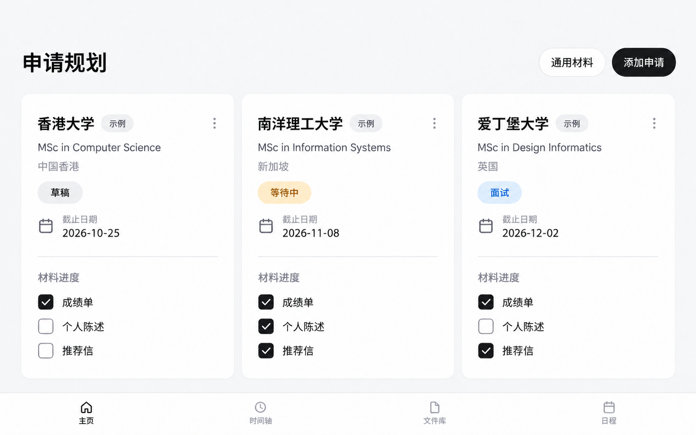
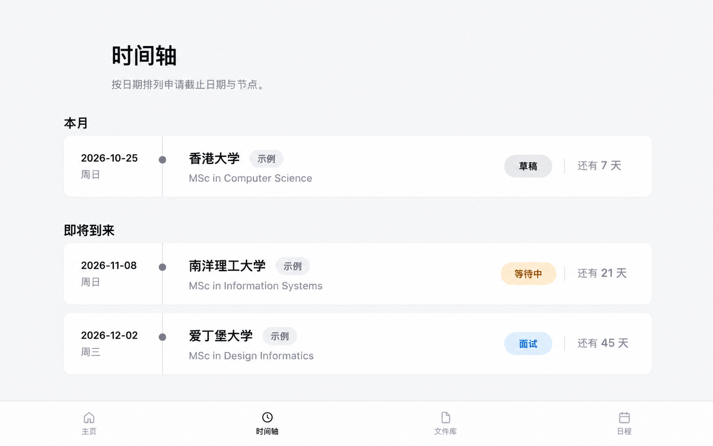
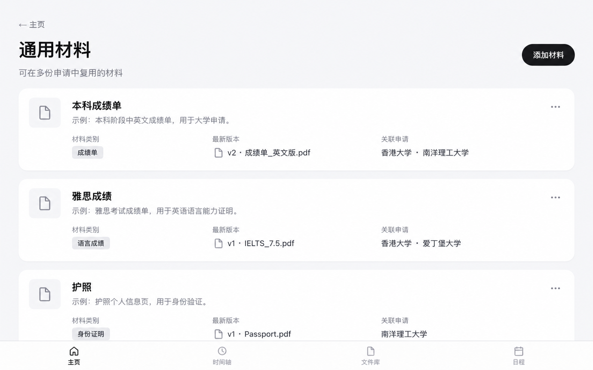
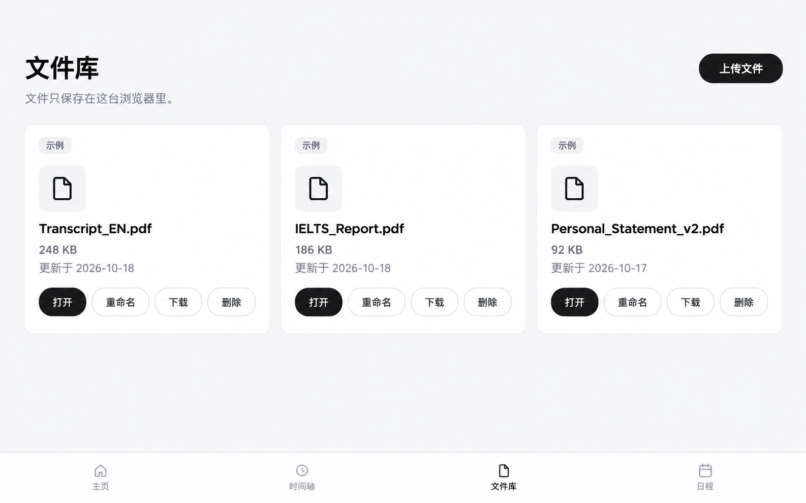
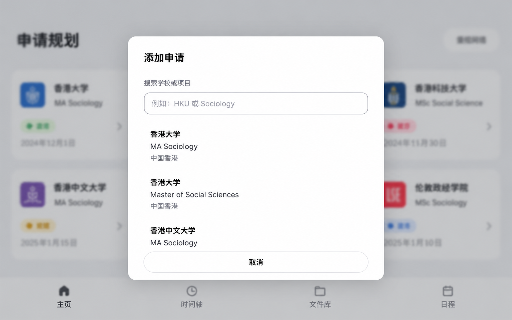
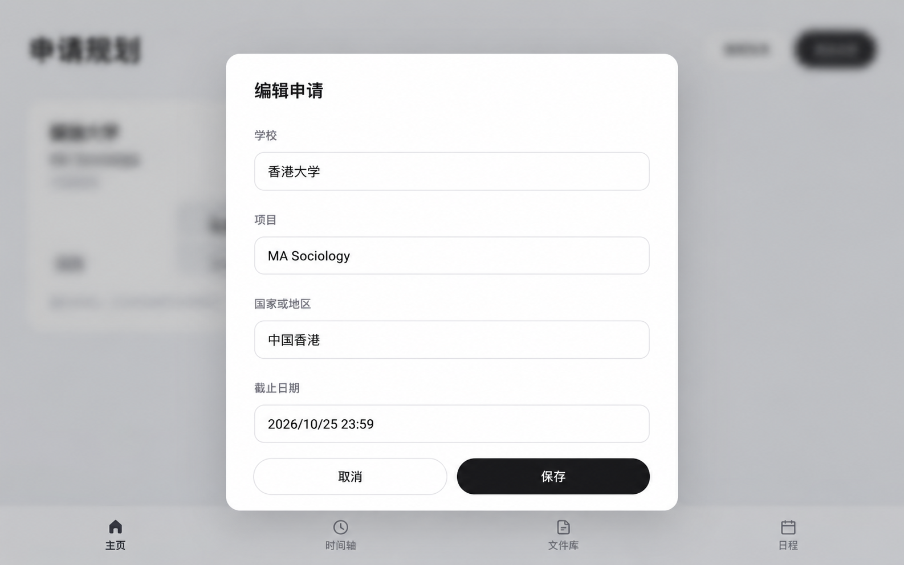
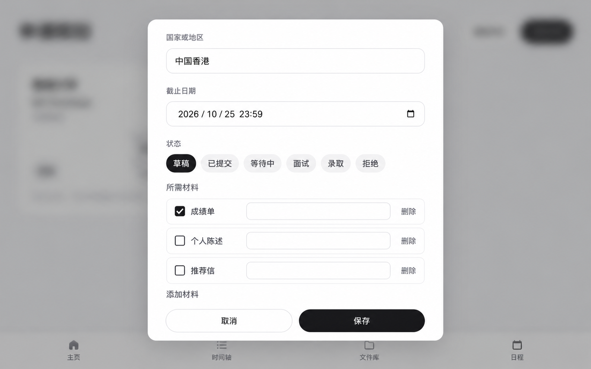
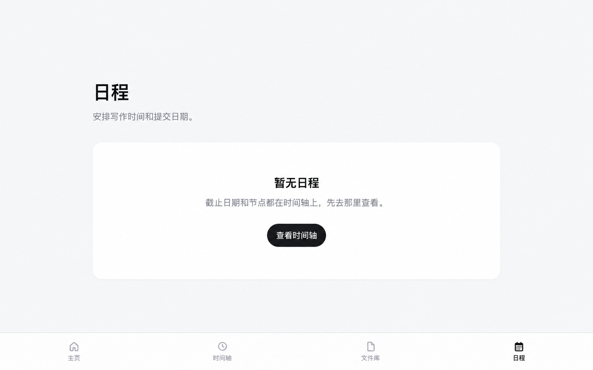

# Application Planner

A lightweight application management tool for graduate school applicants.

Application Planner helps users organize programs, deadlines, required materials, and application progress in one place — while exploring how AI can reduce the manual work of turning scattered admission information into actionable application data.

🔗 **Live Demo:** https://grad-application-planner.netlify.app

---

## Why I Built This

While preparing my own graduate school applications, I found that the hardest part was not simply keeping a checklist.

Information was scattered across university websites, program pages, PDFs, and application portals. For every program, I repeatedly had to figure out:

- When is the deadline?
- What documents are required?
- Which materials are optional or recommended?
- What have I already completed?
- What should I work on next?

The real problem gradually became clear:

> How can scattered, unstructured admission information be turned into a personal application plan?

Application Planner started as a simple application tracker and gradually evolved around this question.

---

## Features

### Application Dashboard

Manage multiple graduate applications in one place, including:

- University
- Program
- Country / Region
- Deadline
- Application status
- Required materials

### Materials Checklist

Track documents required for each application, such as:

- Personal Statement
- CV / Resume
- Transcript
- Recommendation Letters
- Language Test
- Passport / ID

### Timeline

View important application deadlines and milestones across different programs in one timeline.

### AI-assisted Information Extraction

Application Planner is also experimenting with AI-assisted extraction of admission information.

The current workflow is:

**University information → AI extraction → Structured fields → User review → Save**

The goal is to extract information such as:

- Deadlines
- Required documents
- Admission requirements
- Other application-related information

Because application deadlines and document requirements are high-stakes information, AI-generated results are reviewed by the user before being saved.

---

## Product Screens

These are edited product illustrations with sample applications and materials, rather than unaltered live screenshots. All image files are committed under `docs/screenshots/`.

### Application dashboard

View timeline, materials, and application editing

### Timeline

### Shared materials

### Document library

### Add and edit applications

### Schedule placeholder

---

## AI: Current Status

The AI extraction feature is still experimental.

Current testing shows that extraction can become unreliable when:

- A page contains multiple deadlines
- Required, recommended, and optional documents appear together
- Admission information is long or poorly structured
- Different universities describe similar requirements differently

Instead of fully automating the process, the current design keeps the user in control of verification and final confirmation.

This project is also an experiment in a broader product question:

> Where should AI reduce manual work, and where should users retain control?

---

## Product Iteration

The first version of Application Planner focused mainly on manually managing applications and checklists.

After using it during my own application process, I realized that the more time-consuming problem happened **before** information entered the planner:

**Official website → Understand information → Identify what matters → Enter it into the planner**

This led me to shift the product toward:

**Unstructured information → Structured application data → Next actions**

AI extraction was introduced as an early attempt to reduce this gap.

---

## Tech Stack

- Next.js
- TypeScript
- React
- AI API
- Netlify
- Cursor / Codex

The project was built with an AI-assisted coding workflow.

My focus has been on defining the product, designing interactions, testing real use cases, identifying failures, and iterating on the experience while using AI coding tools to implement the product.

---

## Current Status

**V1 is live.**

🔗 https://grad-application-planner.netlify.app

Current development focuses on improving:

- AI extraction reliability
- Multiple-deadline handling
- Required / Recommended / Optional document classification
- User verification before data is saved
- Turning application information into clearer next actions

---

## About

Application Planner is an independent side project built from a problem I encountered during my own graduate application process.

It represents my first attempt to take a product through the full process of:

**Problem discovery → Product definition → MVP → Real-world use → Iteration → AI integration → Deployment**

The project is still evolving, but the goal is simple: build something that is genuinely useful in my own application process rather than a demo created only for a portfolio.
